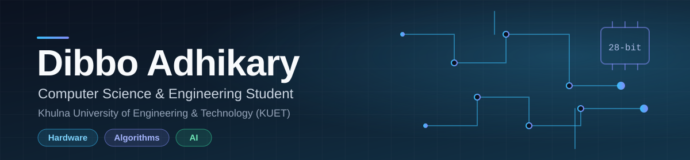

 

---

## About

Computer Science and Engineering student at **Khulna University of Engineering & Technology (KUET)**. I build across the stack, from digital logic on FPGAs to graph algorithms and numerical methods in C++, and desktop and web applications integrated with the Google Gemini API.

Each repository is a complete, working project built to understand a concept in depth, with the source open to read.

## Selected Work

| Project | Domain | Stack |
| :-- | :-- | :-- |
| [**CareerForge**](https://github.com/Dibbo008/CareerForge-Desktop) | Desktop application, AI integration | Java 21, JavaFX, SQLite, Gemini API |
| [**EcoSense**](https://github.com/Dibbo008/EcoSense-Android) | Android application | Java, Room, Retrofit, Firebase |
| [**FPGA Digital Voting Machine**](https://github.com/Dibbo008/FPGA-Digital-Voting-Machine) | Digital design | Verilog, Xilinx Artix-7 (Basys 3) |
| [**28-Bit CPU Design**](https://github.com/Dibbo008/28-BIT-CPU-Design) | Computer architecture | Logisim |
| [**Numerical Theories**](https://github.com/Dibbo008/Numerical-Theories) | Numerical methods | C++ |
| [**Advance Algorithms**](https://github.com/Dibbo008/Advance-Algorithms) | Graph algorithms | C++ |
| [**Zippy AI Assistant**](https://github.com/Dibbo008/Zippy-AI-Assistant) | Web, AI integration | React, Vite, Gemini API |

## Technical Stack

| Category | Technologies |
| :-- | :-- |
| Languages |        |
| Desktop |      |
| Mobile |     |
| Web |      |
| Hardware Tools |     |
| AI |  |

## Featured Projects

### CareerForge: AI Resume and Career Builder

[Repository](https://github.com/Dibbo008/CareerForge-Desktop) | Java 21, JavaFX 21, SQLite, Jackson, Apache PDFBox, Google Gemini API

A JavaFX desktop application for creating resumes and cover letters, backed by a local SQLite database and enhanced with Google Gemini. If no API key is available or a request fails, it falls back to a local generator, so the application remains fully functional offline. Developed as a university Java coursework project.

- Secure user accounts with salted password hashing
- Resume builder with live preview, Classic and Modern templates, and light and dark themes
- AI-generated summaries and cover letters with automatic offline fallback
- PDF and JSON export and import, plus a searchable table of saved resumes
- Role-to-learning-resource wizard using hand-curated resources, with no generated links
- Interview preparation chart and job application tracker

Engineering details

 

| Concept | Implementation |
| :-- | :-- |
| Abstraction and inheritance | `Person` (abstract), `Applicant`, `Student` |
| Generics | `GenericDAO<T>` for data access |
| Multithreading | Three-thread pool through `TaskManager` keeps the UI responsive |
| Asynchronous networking | `HttpClient.sendAsync()` with `CompletableFuture`, responses parsed with Jackson |
| Database design | Nine SQLite tables, cascade deletes, `PreparedStatement` for every query, transactional resume writes |

### EcoSense: Android App

[Repository](https://github.com/Dibbo008/EcoSense-Android) | Java, Android Studio, Room, Retrofit, Firebase Authentication, Cloud Firestore

An Android application written in Java that stores environmental logs locally with Room, syncs them to the cloud with Firebase, and works without an account through an offline guest mode.

- Email and password sign-in with Firebase Authentication, and cloud sync through Cloud Firestore
- Local persistence with Room and a custom ContentProvider
- History screen built on RecyclerView with DiffUtil, Linear and Grid layouts
- Background Service, BroadcastReceiver and notifications
- Retrofit client for remote API calls
- CSV export of saved logs
- Linear regression with a custom trend chart view

### FPGA Digital Voting Machine

[Repository](https://github.com/Dibbo008/FPGA-Digital-Voting-Machine) | Verilog, Xilinx Artix-7 (Basys 3)

An electronic voting system implemented in hardware. It authenticates voter IDs, blocks double voting with a per-voter registry, shows live counts, and announces the winner and runner-up when voting ends.

- Button debouncing for reliable input
- Time-multiplexed 4-digit 7-segment display
- Inputs: 8 switches (candidate and voter ID) and 3 push buttons (vote, finish, reset); error indication through an LED

### 28-Bit CPU Design

[Repository](https://github.com/Dibbo008/28-BIT-CPU-Design) | Logisim

A custom 28-bit CPU with its own ALU, built as Logisim circuits. The repository includes an architecture write-up (PDF) and program files for ADD, SUB, AND, OR, MUL and DIV.

### Algorithms and Numerical Methods

| Project | Language | Contents |
| :-- | :-- | :-- |
| [Numerical-Theories](https://github.com/Dibbo008/Numerical-Theories) | C++ | **Root finding:** Bisection, False-Position, Newton-Raphson, Secant. **Linear systems:** Gauss Elimination, Gauss-Jordan, LU decomposition, matrix inversion. **Interpolation:** Newton's forward and backward. **Regression:** linear, power, polynomial. **Integration and ODEs:** Simpson's 1/3 and 3/8, Runge-Kutta 4th order. |
| [Advance-Algorithms](https://github.com/Dibbo008/Advance-Algorithms) | C++ | **Shortest paths:** Dijkstra, Bellman-Ford, Floyd-Warshall, Johnson. **Minimum spanning trees:** Kruskal, Prim. |
| [Epitrack-DSA](https://github.com/Dibbo008/Epitrack-DSA) | C++ | Data structures and algorithms practice. |

### AI and Web Applications

| Project | Stack | Description |
| :-- | :-- | :-- |
| [Zippy-AI-Assistant](https://github.com/Dibbo008/Zippy-AI-Assistant) | React, Vite, Gemini API | Dog-themed virtual assistant with voice input through the browser SpeechRecognition API. Deployed on Netlify. |
| [PiXEE-AI-Bot](https://github.com/Dibbo008/PiXEE-AI-Bot) | React, Vite, Gemini 2.5 Flash | Creative chat companion prototype that accepts image uploads as conversation context. Deployed on Netlify. |

## More Repositories

| Repository | Language | Description |
| :-- | :-- | :-- |
| [AiZen-AI-RnC](https://github.com/Dibbo008/AiZen-AI-RnC) | JavaScript | AI-driven web application |
| [Votebox-EVM](https://github.com/Dibbo008/Votebox-EVM) | JavaScript | Web-based electronic voting machine |
| [SDN-Network-Sim](https://github.com/Dibbo008/SDN-Network-Sim) | JavaScript | Software-defined networking simulation |
| [COBRA.C-Game](https://github.com/Dibbo008/COBRA.C-Game) | C | Game written in C |

## Education

**Bachelor of Science in Computer Science and Engineering**
Khulna University of Engineering & Technology (KUET), Khulna, Bangladesh

## Research Interests

- Applied machine learning and AI-assisted software
- FPGA-based systems and custom processor architecture
- Software-defined networking and network simulation
- Graph algorithms and numerical computation

---

Open to collaboration on projects in algorithms, hardware design, and AI.

