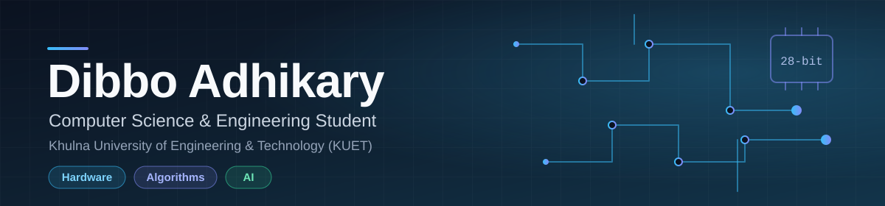

 

---

## About

I am a Computer Science and Engineering student at Khulna University of Engineering & Technology (KUET). My work spans the computing stack: digital logic on FPGAs, graph algorithms and numerical methods in C++, and desktop and web applications that use the Google Gemini API.

Each repository is a working project built to understand a concept properly, with the source open to read.

| Area | What I work on |
| :-- | :-- |
| Hardware and Digital Design | FPGA development, custom CPU architecture, Verilog and VHDL |
| Algorithms and Numerical Methods | Graph algorithms, root finding, linear systems, interpolation, regression, integration |
| Artificial Intelligence | AI assistants and chatbots built on the Google Gemini API |
| Software Development | JavaFX desktop applications, React web applications, game programming in C |

## Technical Stack

| Category | Technologies |
| :-- | :-- |
| Languages |        |
| Desktop |      |
| Web |      |
| Hardware Tools |     |
| AI |  |

## Featured Projects

### CareerForge: AI Resume and Career Builder

[Repository](https://github.com/Dibbo008/CareerForge-Desktop) | Java 21, JavaFX 21, SQLite, Jackson, Apache PDFBox, Google Gemini API

A JavaFX desktop application for building professional resumes and cover letters, backed by a local SQLite database and enhanced with Google Gemini. When no API key is available, or a request fails, it falls back to a local generator, so the whole app works offline.

- Secure accounts with salted password hashing
- Dynamic resume builder with live preview, Classic and Modern templates, and light and dark themes
- AI-generated summaries and cover letters with automatic offline fallback
- PDF and JSON export and import, and a searchable table of saved resumes
- To The Point: a two-question wizard that maps a target role to hand-curated learning resources, with no generated links
- Interview preparation chart and a job application tracker

Engineering details

 

| Concept | Implementation |
| :-- | :-- |
| Abstraction and inheritance | `Person` (abstract), `Applicant`, `Student` |
| Generics | `GenericDAO<T>` for data access |
| Multithreading | Three-thread pool through `TaskManager` keeps the UI responsive |
| Asynchronous networking | `HttpClient.sendAsync()` with `CompletableFuture`, responses parsed with Jackson |
| Database design | Nine SQLite tables, cascade deletes, `PreparedStatement` for every query, transactional resume writes |

### Hardware Design

| Project | Description |
| :-- | :-- |
| [FPGA-Digital-Voting-Machine](https://github.com/Dibbo008/FPGA-Digital-Voting-Machine) | An electronic voting system in Verilog for the Xilinx Artix-7 (Basys 3). It authenticates voter IDs, blocks double voting with a per-voter registry, shows live counts, and announces the winner and runner-up. Includes button debouncing and a time-multiplexed 4-digit 7-segment display. |
| [28-BIT-CPU-Design](https://github.com/Dibbo008/28-BIT-CPU-Design) | A custom 28-bit CPU with its own ALU, built as Logisim circuits. The repository includes an architecture write-up and program files for ADD, SUB, AND, OR, MUL and DIV. |

### AI and Web Applications

| Project | Stack | Description |
| :-- | :-- | :-- |
| [Zippy-AI-Assistant](https://github.com/Dibbo008/Zippy-AI-Assistant) | React, Vite, Gemini API | A dog-themed virtual assistant with voice input through the browser SpeechRecognition API. Deployed on Netlify. |
| [PiXEE-AI-Bot](https://github.com/Dibbo008/PiXEE-AI-Bot) | React, Vite, Gemini 2.5 Flash | A creative chat companion prototype that accepts image uploads as conversation context. Deployed on Netlify. |
| [AiZen-AI-RnC](https://github.com/Dibbo008/AiZen-AI-RnC) | JavaScript | An AI-driven web application. |
| [Votebox-EVM](https://github.com/Dibbo008/Votebox-EVM) | JavaScript | An electronic voting machine project for the web. |

### Algorithms and Numerical Methods

| Project | Language | Contents |
| :-- | :-- | :-- |
| [Advance-Algorithms](https://github.com/Dibbo008/Advance-Algorithms) | C++ | Shortest paths: Dijkstra, Bellman-Ford, Floyd-Warshall, Johnson. Spanning trees: Kruskal, Prim. |
| [Numerical-Theories](https://github.com/Dibbo008/Numerical-Theories) | C++ | Root finding (Bisection, False-Position, Newton-Raphson, Secant), linear systems (Gauss Elimination, Gauss-Jordan), LU decomposition, matrix inversion, Newton's interpolation, linear, power and polynomial regression, Simpson's rules, Runge-Kutta 4th order. |
| [Epitrack-DSA](https://github.com/Dibbo008/Epitrack-DSA) | C++ | Data structures and algorithms practice. |

### Other

| Project | Language | Description |
| :-- | :-- | :-- |
| [SDN-Network-Sim](https://github.com/Dibbo008/SDN-Network-Sim) | JavaScript | Software-defined networking simulation. |
| [COBRA.C-Game](https://github.com/Dibbo008/COBRA.C-Game) | C | A game written in C. |

## Education

**Bachelor of Science in Computer Science and Engineering**
Khulna University of Engineering & Technology (KUET), Khulna, Bangladesh

## Research Interests

- Applied machine learning and AI-assisted software
- FPGA-based systems and custom processor architecture
- Software-defined networking and network simulation
- Graph algorithms and numerical computation

## GitHub at a Glance

 

---

Open to collaboration on projects in algorithms, hardware design, and AI.

